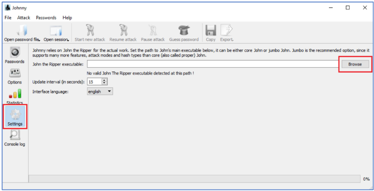
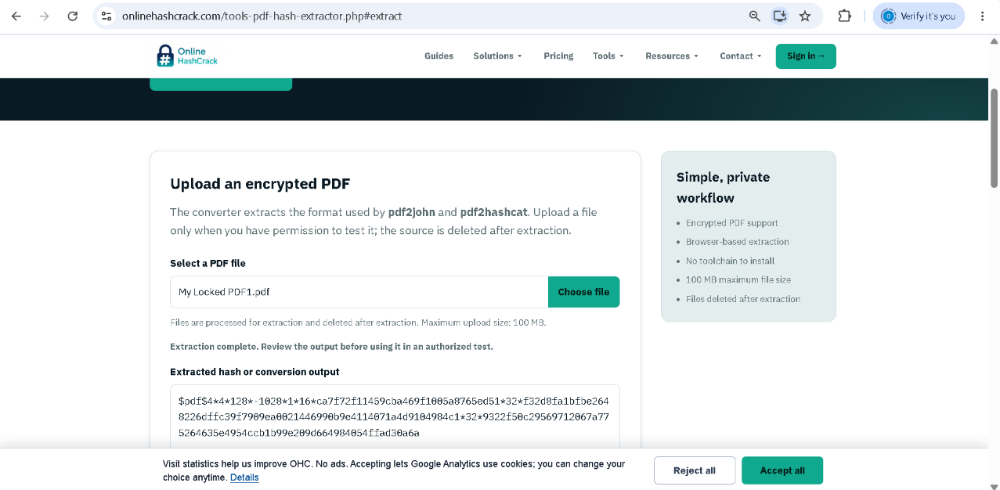
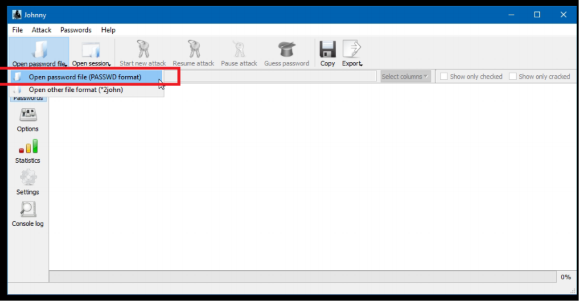
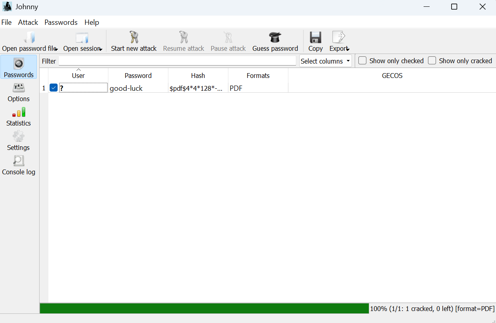
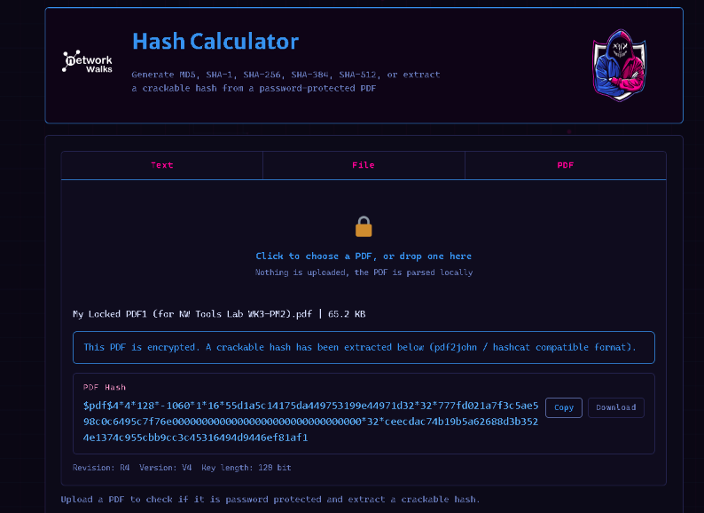
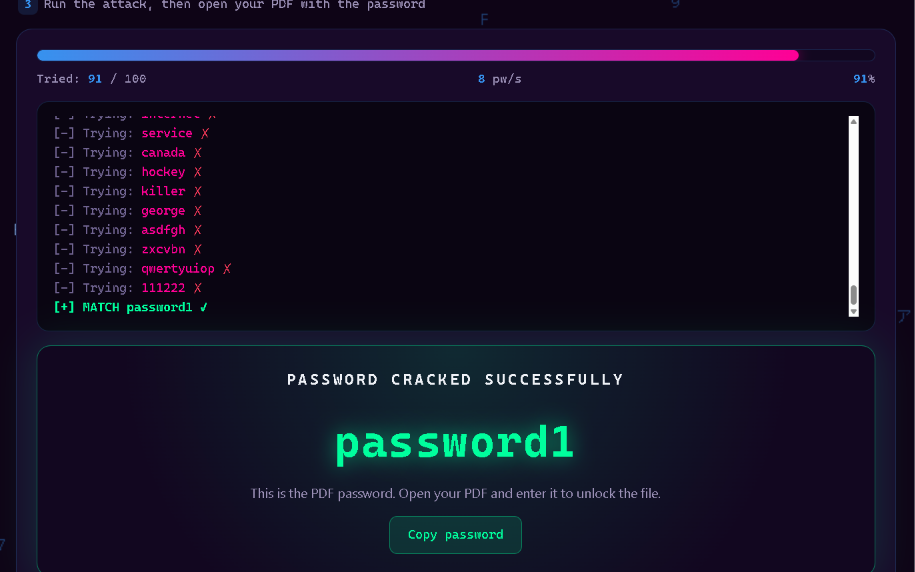
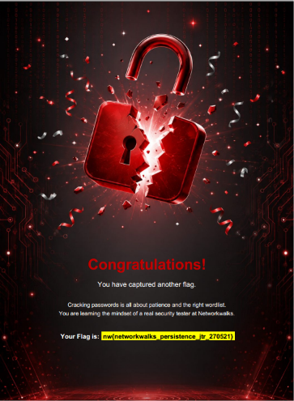

# NetworkWalks Cyber Security B084-Week-3-Password-Security-JTR
The week-3 Cyber security task is pdf password cracking using john the ripper JTR along with john CL and Networkwalks password has generator and cracking web tool

Primary learning objectives:
* Password hashing concepts
* Password-cracking concepts (authorized recovery only)
* John the Ripper (CLI)
* Johnny GUI
* Hash extraction (e.g. PDF → JTR hash)
* Evidence collection
* Security documentation
* Defensive password recommendations

  My Steps;
  * I downloaded the passworded pdf files from the google drive materials
  https://drive.google.com/drive/folders/1BipNY5NSQpPB3KSJwdJiu6X0VA1FVbcM
  * I downloaded johnny the ripper JRT GUI and john CLI from the google drive material
  * I installed johnny on my windows system
  * After successful installation, I linked john the ripper CLI, by clicking on settings and the browse
  
  * I now uploaded the password pdf file to
    https://www.onlinehashcrack.com/tools-pdf-hash-extractor.php#extract
    to generate the password hash
    
  * I copied the generated hash and saved it to a text file then
  * I clicked on Open password file in JTR to add the saved password hash text file
    
  * Then I clicked on start a new attack and then the password was cracked successfully
    
  The process was repeated for the other two passworded pdf files
Steps undertaken for the Networkwalks pdf file password cracking tool
* I opened the https://networkwalks.com/hash-calculator/ link in my web browser
* Then clicked on the pdf tab to upload the passworded pdf file which then generated the password hash
  
* I copied the hash generated then
* opened https://networkwalks.com/password-cracker/
* Then pasted the copied hash into the pdf hash text area
* Then clicked on start cracking
  

  PDF Contents
  
  
  
  Module Result
  

